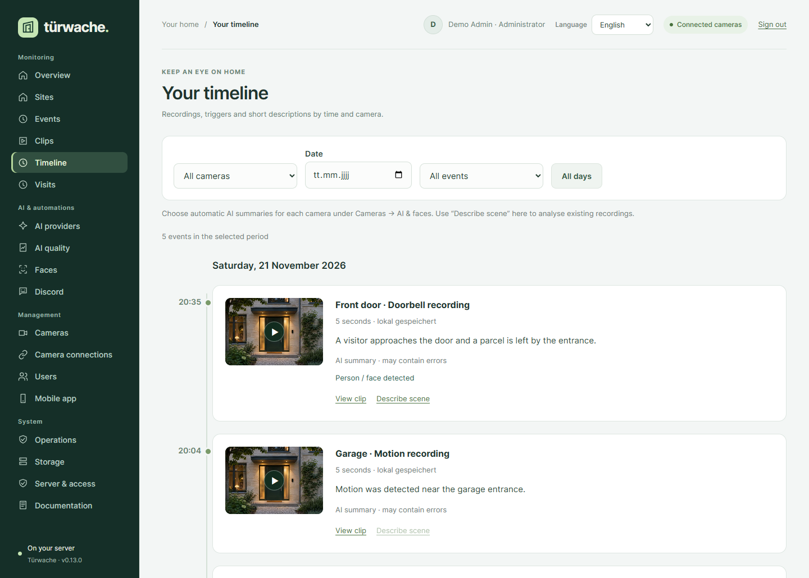
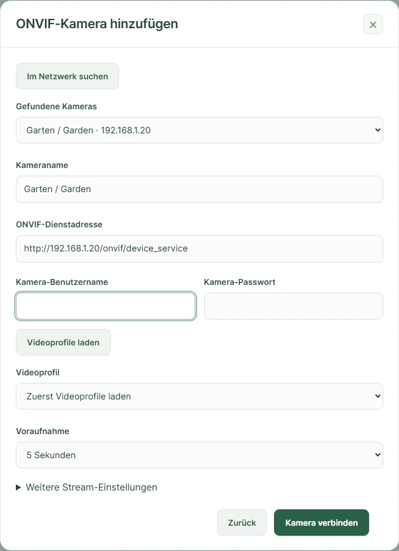

# Türwache

[English](README.md) · [Download](https://github.com/xKeRnx/tuerwache/releases/latest) · [Dokumentation](docs/index.md) · [Privatnutzungslizenz](LICENSE.md)

Privater Kameraserver für **Ring, ONVIF und RTSP** mit deutscher und englischer Weboberfläche. Verwalte mehrere Kameras und Standorte, Livebild, Clips mit Ton, Kamera- und Cliprechte, Privatzonen und Benachrichtigungen. Lokale Personen- und Gesichtserkennung sowie KI-Beschreibungen, Discord und R2/S3 sind optional.

Netzwerkkameras lassen sich per ONVIF suchen oder mit einer RTSP-Adresse eintragen. Bei dauerhaft erreichbaren Streams sind bis zu 15 Sekunden Voraufnahme einstellbar. Ring-Kameras verwenden weiterhin ein Ring-Konto und ihre Cloud-Verbindung. Akkugeräte können den Anfang eines Ereignisses verpassen.

[](docs/screenshots/timeline.webp)

Die Aufnahmen der Oberfläche verwenden Beispieldaten. In der [Bildergalerie](README.md#take-a-look-around) siehst du außerdem Standorte, Cliparchiv, Kameraeinrichtung, Benutzerrechte, KI-Anbieter und die Serververwaltung.

## Schnellstart

Node.js 24 LTS installieren (22 ebenfalls unterstützt); für lokale KI Python 3.12.

Windows, PowerShell im Projekt:

```powershell
powershell -NoProfile -ExecutionPolicy Bypass -File .\scripts\Install-Windows.ps1 -WithAI
powershell -NoProfile -ExecutionPolicy Bypass -File .\scripts\Start-Tuerwache.ps1
```

Linux, Node/npm und für KI python3-venv vorausgesetzt:

```bash
bash scripts/install-linux.sh --with-ai
bash scripts/start-linux.sh
```

Ohne lokale Analyse die KI-Option weglassen. Zuerst mit `-CheckOnly` bzw. `--check-only` prüfen. [App öffnen](http://127.0.0.1:3210), Türwache-Konto anlegen und unter **Kameraverbindungen** Ring oder eine Netzwerkkamera hinzufügen. Die [Doku im Browser](http://127.0.0.1:3210/docs) ist in beiden Sprachen verfügbar.

## Anleitungen

- [Windows](docs/windows.md) · [Linux/systemd/Docker](docs/linux.md) · [Raspberry Pi](docs/raspberry-pi.md)
- [ONVIF-Suche, RTSP und Voraufnahme](docs/network-cameras.md)
- [Kameras, KI, Gesichter, Discord und Fehler](docs/usage.md)
- [HTTPS, Backup, Updates und GitHub](docs/operations.md) · [Proxy-Details](deploy/README.md)
- [Architektur und Handy-Status](docs/architecture.md) · [Lokaler Betrieb und Hilfe](docs/saas.md)



## Lizenz und Veröffentlichung

Der eigene Code ist unter der [Türwache-Privatnutzungslizenz](LICENSE.md) für private Zwecke kostenlos nutzbar. Änderungen müssen auch bei privater Nutzung veröffentlicht werden. Geschäftliche Nutzung, Verkauf, entgeltliches Hosting und Weitergabe in bezahlten Paketen sind ausgeschlossen. Fremdkomponenten behalten ihre Lizenzen. Die [GitHub-Anleitung](docs/github.md) beschreibt die Vorbereitung der Veröffentlichung.

```powershell
node scripts/prepare-repository.mjs --public --destination H:\Tuerwache-Public-Export
```

Der Quellcode-Export benötigt einen leeren Zielordner. Vor einem öffentlichen Upload auf manuell eingebettete Zugangsdaten prüfen. In der App ist die Doku unter **System → Dokumentation** verfügbar. Die Türwache-Website kann dieselben Anleitungen unter `/dokumentation/` ausliefern.

## Entwicklung

```bash
npm run check
npm test
node scripts/build-docs.mjs
```

Markdown unter `docs/` wird zu `public/docs.html` gebaut. Die SaaS-Version verwendet eine getrennte Codebasis und Datenablage.
