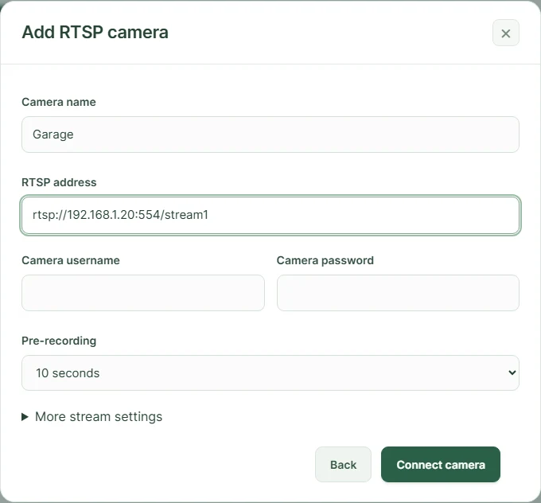

# Türwache

[Deutsch](README.md) · [Documentation](docs/index.en.md) · [Private use license](LICENSE.md)

Private camera server for **Ring, ONVIF and RTSP** with a German and English web interface. Manage multiple cameras and sites, live video, clips with audio, camera and clip permissions, privacy masks, and notifications. Local person and face recognition, AI descriptions, Discord and R2/S3 are optional.

Discover network cameras over ONVIF or add an RTSP address manually. Always-on streams can buffer up to 15 seconds before recording. Ring devices still use their own account and cloud connection. Battery-powered devices can miss the beginning of an event.

## Quick start

Install Node.js 24 LTS (22 also supported), plus Python 3.12 for local AI.

```powershell
# Windows, from the project directory
powershell -NoProfile -ExecutionPolicy Bypass -File .\scripts\Install-Windows.ps1 -WithAI
powershell -NoProfile -ExecutionPolicy Bypass -File .\scripts\Start-Tuerwache.ps1
```

```bash
# Linux with Node/npm and optional python3-venv installed
bash scripts/install-linux.sh --with-ai
bash scripts/start-linux.sh
```

Omit the AI option if it is not needed. Use `CheckOnly` or `--check-only` for prerequisite checks. Open [the app](http://127.0.0.1:3210), create a Türwache account and add a camera under **Camera connections**. The [browser documentation](http://127.0.0.1:3210/docs) is available in both languages.

- [Windows](docs/windows.en.md), [Linux/systemd/Docker](docs/linux.en.md), [Raspberry Pi](docs/raspberry-pi.en.md)
- [ONVIF discovery, RTSP and pre-recording](docs/network-cameras.en.md)
- [Cameras/AI/Discord](docs/usage.en.md), [Security/backups/upgrades/GitHub](docs/operations.en.md)
- [Architecture/mobile](docs/architecture.en.md), [Local operation and help](docs/saas.en.md)



## Licensing and publication

Original code is available for private use under the [Türwache Private Use License](LICENSE.md). Publish the corresponding source of changes even for private use. Business use, sale, paid hosting and distribution as part of a paid bundle are prohibited. Third-party components retain their licenses. The [GitHub guide](docs/github.en.md) covers release preparation.

```powershell
node scripts/prepare-repository.mjs --public --destination H:\Tuerwache-Public-Export
```

Use an empty destination and review the source export for embedded credentials before publishing. In the app, open **System → Documentation**. The Türwache website can serve the same guides at `/dokumentation/`.

Run `npm run check`, `npm test` and `node scripts/build-docs.mjs` during development. Markdown is compiled into `public/docs.html`. The SaaS edition uses separate code and data.

