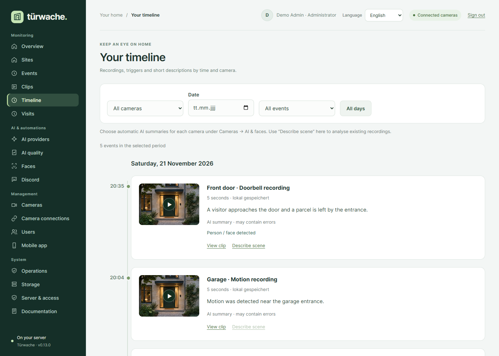
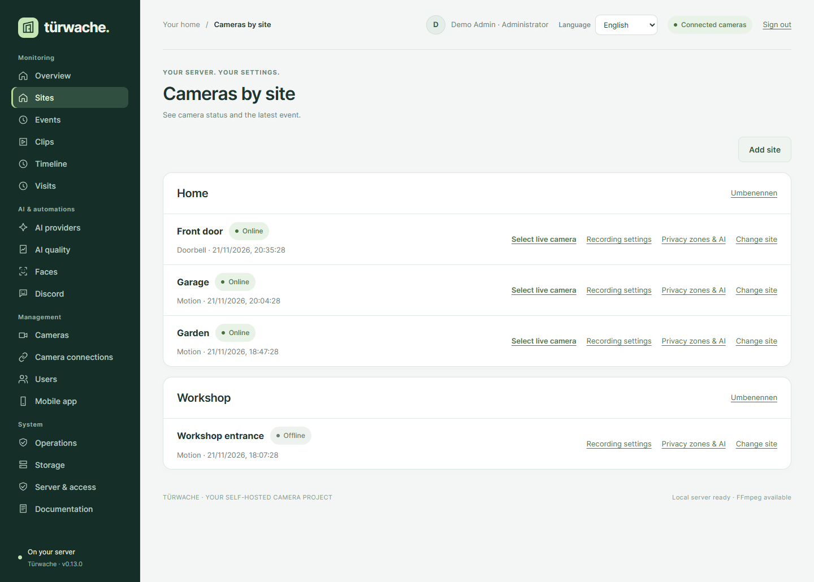
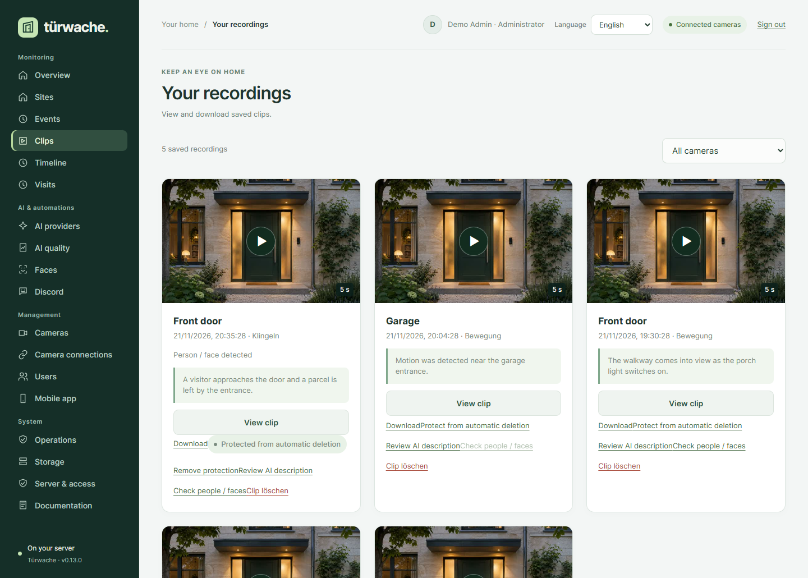
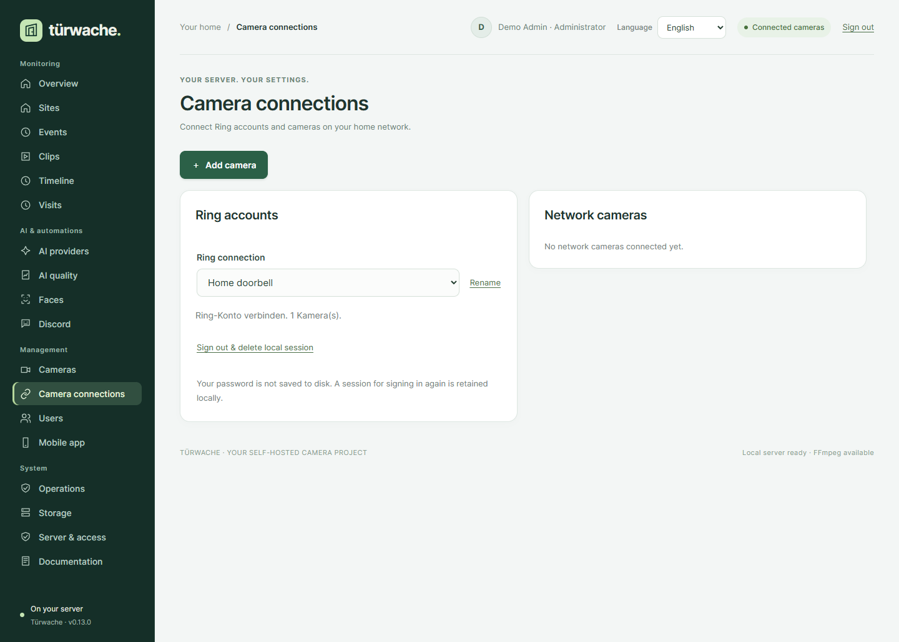
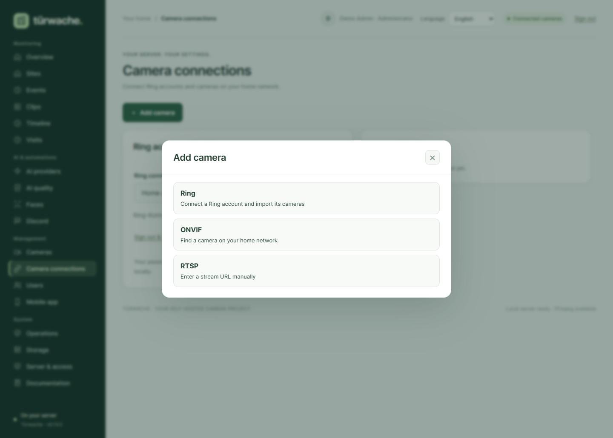
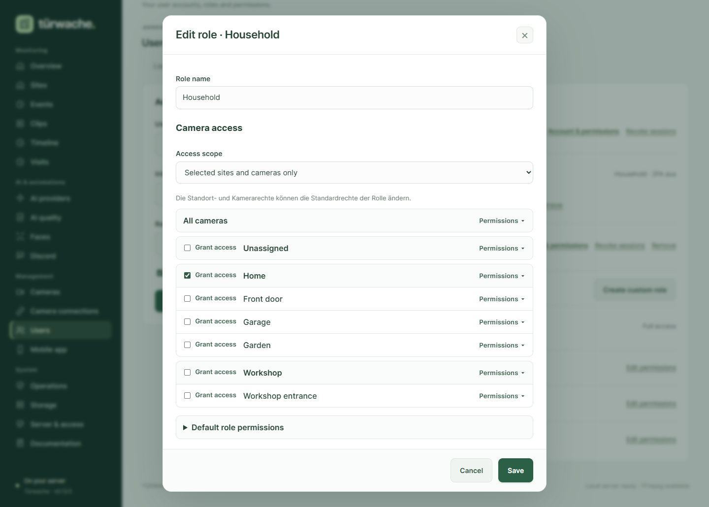
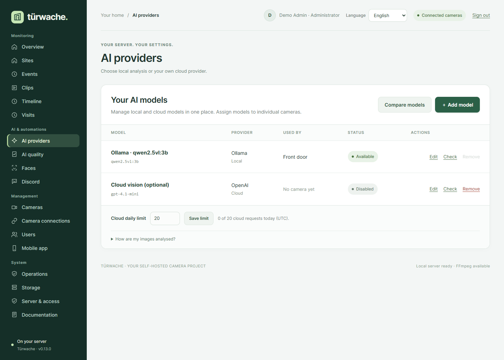
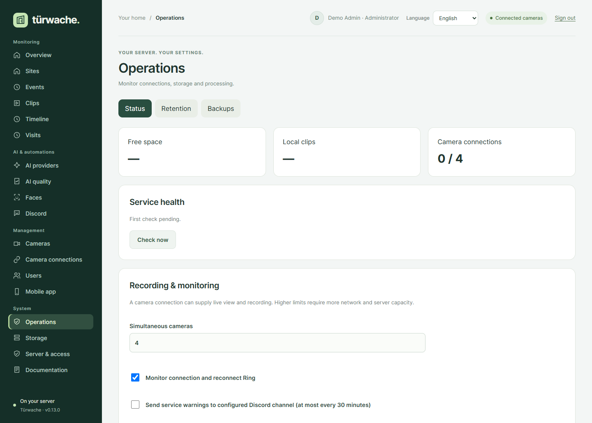
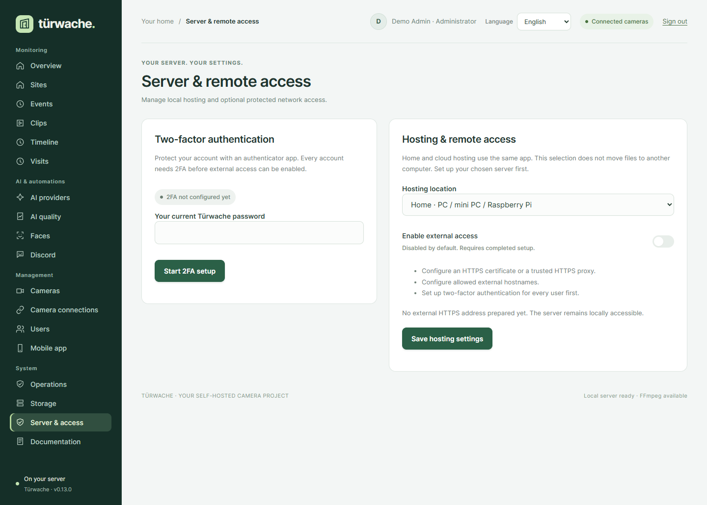

# Türwache

**Your cameras, your server.** Türwache is a self-hosted camera dashboard and recorder for **Ring, ONVIF, and RTSP**. Connect cameras across multiple sites, see what happened at the door, and choose who can watch, record, or export clips. Recordings are stored on your own server by default.

[Download the latest release](https://github.com/xKeRnx/tuerwache/releases/latest) · [Setup guides](https://tuerwache.de/dokumentation/) · [Deutsch](README.de.md) · [Private Use License](LICENSE.md)

[](docs/screenshots/timeline.webp)

The screenshots show the local app with sample cameras, users, and recordings.

## Take a look around

| Cameras by site | Recordings and playback |
| --- | --- |
| [](docs/screenshots/sites.webp) | [](docs/screenshots/clips.webp) |
| See which cameras are online, check the latest event, and change recording settings per camera. | Browse thumbnails, watch clips, and keep important recordings from being removed by automatic cleanup. |
| **Camera connections** | **Add a camera** |
| [](docs/screenshots/camera-connections.webp) | [](docs/screenshots/add-camera.webp) |
| Connect multiple Ring accounts and manage cameras from your home network in the same app. | Search for ONVIF devices on the LAN or enter an RTSP stream address directly. |
| **Users and camera permissions** | **AI models per camera** |
| [](docs/screenshots/user-permissions.webp) | [](docs/screenshots/ai-models.webp) |
| Define what a role can do and give individual users different rights for specific cameras or sites. | Run descriptions locally with Ollama or choose a compatible API. Assign models individually and limit daily cloud requests. |
| **Operations and backups** | **Two-factor authentication and remote access** |
| [](docs/screenshots/operations.webp) | [](docs/screenshots/server-access.webp) |
| Check service health and stream capacity, choose retention rules, and manage encrypted backups. | Set up two-factor authentication and enable HTTPS access when you want to reach the server remotely. |

## What you can do

| Feature | How it works |
| --- | --- |
| **Live view and recording** | Open a live view or start a recording manually. Configure Ring doorbell and motion triggers, recording duration, and cooldown per camera. Always-on ONVIF and RTSP streams can buffer up to 15 seconds before recording. |
| **Timeline and visits** | Filter recordings and events by camera, date, or event type. Open Visits to see related motion, doorbell events, and clips together. |
| **Person and face recognition** | Enable the optional local detection worker. Add reference photos with consent, review unknown face suggestions, and assign a name when you recognise someone. |
| **AI scene descriptions** | Run image-capable models through a local service such as Ollama or select a cloud API for a camera. Compare models on the same clip and review their results. Cloud analysis sends sampled frames and scene context to the selected provider. |
| **Permissions and privacy** | Control live view, clips, exports, and management actions by user, role, site, or camera. Draw privacy zones for exported and forwarded clips. |
| **Notifications** | Configure Discord notifications per camera and manage mobile push quiet hours per user, with an optional doorbell exception. |
| **Storage and maintenance** | Keep clips in a local directory and optionally add private S3-compatible or Cloudflare R2 copies. Set retention rules, protect individual clips, and create encrypted backups. |

Ring cameras still use a Ring account and Ring's cloud connection. Wake-up delays on battery-powered cameras can affect the start of a recording.

## Quick start

1. [Download and unpack the release ZIP](https://github.com/xKeRnx/tuerwache/releases/latest).
2. Install Node.js 24 LTS or Node.js 22 and follow the instructions below.
3. Open [http://127.0.0.1:3210](http://127.0.0.1:3210), create a Türwache administrator account, and open **Camera connections** to add your first camera.

### Windows

Open PowerShell in the unpacked folder.

```powershell
powershell -NoProfile -ExecutionPolicy Bypass -File .\scripts\Install-Windows.ps1
powershell -NoProfile -ExecutionPolicy Bypass -File .\scripts\Start-Tuerwache.ps1
```

### Linux and Raspberry Pi

Open a terminal in the unpacked folder.

```bash
bash scripts/install-linux.sh
bash scripts/start-linux.sh
```

Use `-WithAI` on Windows or `--with-ai` on Linux to install the optional local recognition components. See the [Raspberry Pi guide](docs/raspberry-pi.en.md) for 64-bit OS requirements and advice on running AI on another machine.

## Documentation and support

- **Installation** · [Windows](docs/windows.en.md) · [Linux and Docker](docs/linux.en.md) · [Raspberry Pi](docs/raspberry-pi.en.md)
- **Camera setup** · [ONVIF, RTSP, and pre-recording](docs/network-cameras.en.md) · [Recording, AI, and notifications](docs/usage.en.md)
- **Administration** · [Access, backups, and updates](docs/operations.en.md) · [Architecture and mobile app](docs/architecture.en.md)
- **Help** · [Bilingual documentation](https://tuerwache.de/dokumentation/) · [Contact](https://tuerwache.de/kontakt/)

## License

The Türwache source code is publicly available under the [Türwache Private Use License](LICENSE.md). Private use is free. Publish the corresponding source of modifications under the same license, including changes made for private use. Commercial use and sale are excluded. Third-party components retain their own licenses.

## Development

After `npm ci`, run `npm run check` and `npm test`. Run `node scripts/build-docs.mjs` to rebuild the documentation served inside the app.
