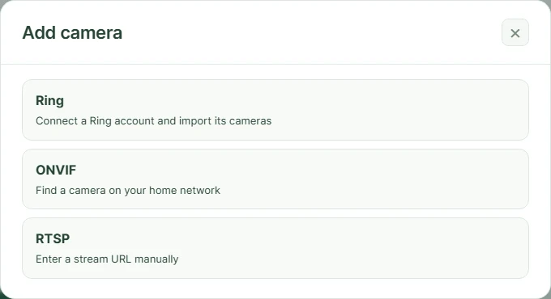
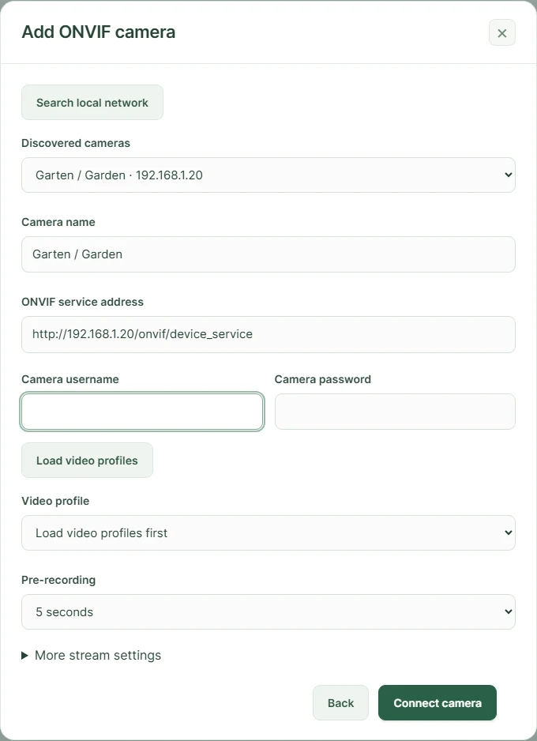
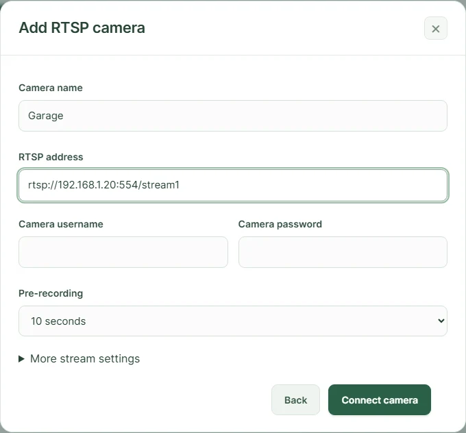

# Connect Ring and network cameras

Run Ring, ONVIF and RTSP cameras in the same installation. As an administrator, open **Camera connections → Add camera** and select the connection type in the dialog. Choose **Ring**, give the connection a name and sign in to Ring. Türwache imports the cameras on that account.

## Discover a camera over ONVIF

- Enable ONVIF in the camera settings. Some cameras need a dedicated ONVIF account. Make sure the server can reach the camera on the local network.
- Choose **ONVIF** in the dialog.
- Select **Search the network**, choose the camera and enter its credentials. If discovery shows nothing, type the service address manually. An example is `http://192.168.1.20/onvif/device_service`.
- Load the video profiles and choose H.264 when available. When adding a recorder with multiple channels, select the desired profile and add other channels separately.
- Choose the pre-recording time and select **Connect camera**. The status turns online after the first complete video segments arrive.

Discovery uses local IPv4 multicast. VLANs, guest networks, multicast filtering and Docker bridge networking can prevent discovery. Entering a reachable ONVIF or RTSP address bypasses the need for discovery. Türwache reads ONVIF media profiles. Camera-event subscriptions, talkback and PTZ controls are outside this integration. [ONVIF Profile T](https://www.onvif.org/profiles/profile-t/)

## Enter an RTSP address

- Choose **RTSP** and enter the stream address, such as `rtsp://192.168.1.20:554/stream1`. Check the camera or recorder manual for its path and port.
- Enter the camera username and password in the dedicated fields. The saved connection is encrypted and the password is never returned to the browser.
- H.264 video is copied into the buffer without another encode. Enable H.264 conversion under **More stream settings** for an H.265 stream if your browser needs it. On a Raspberry Pi, choose H.264 directly on the camera whenever possible.

## Pre-recording, motion and storage

While monitoring is enabled, Türwache reads the network stream continuously and keeps recent video segments under `data/network-buffer`. The rolling buffer is replaced as new footage arrives. It is available for manual recordings and software motion triggers. Set the target to 0, 5, 10 or 15 seconds.

The actual pre-recorded time depends on the available footage and the camera's keyframes. H.264 with a keyframe interval around two seconds makes recording boundaries more predictable. If the stream is interrupted, Türwache retains readable segments and marks the shorter clip. Ring cameras without a continuous stream continue to record through the existing Ring connection.

Motion detection compares small grayscale frames and can react to lighting changes or weather. Under **More stream settings**, you can supply a separate RTSP address for motion detection. The primary stream keeps its full recording resolution, and the substream reconnects independently after interruptions.

Person and face detection run separately on saved clips. On a Raspberry Pi, use a small substream and a low limit for active streams under **Operations**. Check the storage load before adding multiple continuous streams. [Raspberry Pi guide](raspberry-pi.en.md)
