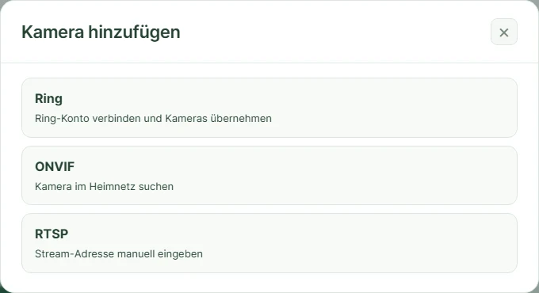
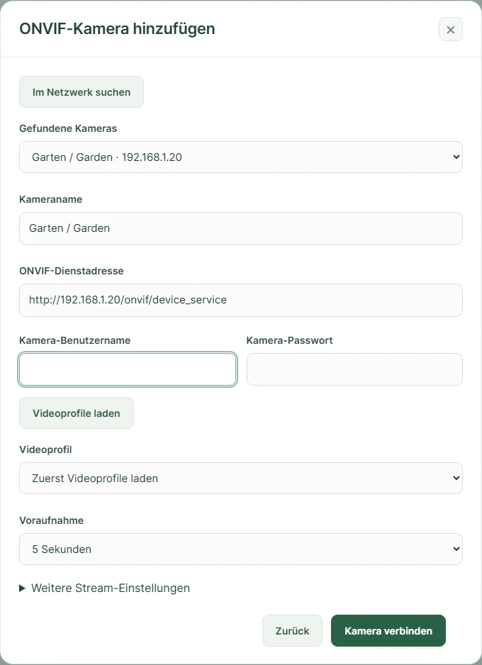
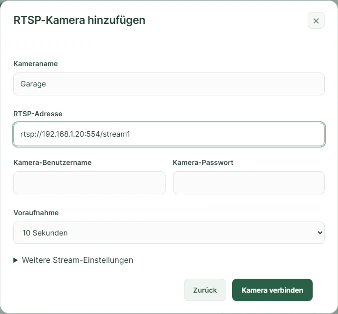

# Ring und Netzwerkkameras verbinden

Ring, ONVIF und RTSP können in derselben Installation laufen. Öffne als Administrator **Kameraverbindungen → Kamera hinzufügen** und wähle im Dialog den Verbindungstyp. Mit **Ring** legst du einen Kontonamen fest und meldest dich anschließend bei Ring an. Türwache übernimmt die Kameras dieses Kontos.

## ONVIF im Netzwerk suchen

- Aktiviere ONVIF im Kameramenü. Manche Kameras verlangen ein eigenes ONVIF-Konto. Prüfe, dass Kamera und Türwache im erreichbaren Heimnetz liegen.
- Wähle im Dialog **ONVIF**.
- Klicke auf **Im Netzwerk suchen**, wähle die Kamera und gib ihre Zugangsdaten ein. Falls die Suche kein Ergebnis zeigt, trage die ONVIF-Dienstadresse direkt ein. Ein Beispiel ist `http://192.168.1.20/onvif/device_service`.
- Lade die Videoprofile und wähle möglichst H.264. Bei mehreren Kanälen eines Rekorders kannst du das gewünschte Profil wählen und weitere Kanäle separat hinzufügen.
- Stelle die Voraufnahme ein und klicke auf **Kamera verbinden**. Sobald fertig geschriebene Segmente vorliegen, zeigt Türwache die Kamera als online an.

Die Suche verwendet IPv4-Multicast im lokalen Netz. Getrennte VLANs, Gastnetze, lokal gefilterter Multicast und Docker-Netzwerkbrücken können die Suche verhindern. Mit der manuellen ONVIF- oder RTSP-Adresse funktioniert die Verbindung auch ohne Multicast, sofern die Kamera erreichbar ist. Türwache fragt ONVIF-Medienprofile ab. Bewegungsmeldungen aus dem Kameraprotokoll, Gegensprechen und PTZ-Steuerung sind in dieser Integration nicht eingerichtet. [ONVIF Profile T](https://www.onvif.org/profiles/profile-t/)

## RTSP-Adresse manuell eintragen

- Wähle **RTSP** und trage die Stream-Adresse ein, zum Beispiel `rtsp://192.168.1.20:554/stream1`. Pfad und Port stehen in der Anleitung der Kamera oder des Rekorders.
- Gib Benutzername und Passwort in den separaten Feldern ein. Die gespeicherte Verbindung ist verschlüsselt, und die Oberfläche liefert das Kennwort später nicht zurück.
- Bei H.264 bleibt das Video beim Schreiben des Puffers unverändert kodiert. Für H.265 kannst du die H.264-Umwandlung unter **Weitere Stream-Einstellungen** einschalten, falls dein Browser den Stream sonst nicht abspielt. Auf dem Raspberry Pi ist ein H.264-Kameraprofil vorzuziehen.

## Voraufnahme, Bewegung und Speicher

Bei aktiver Überwachung liest Türwache den Netzwerkstream fortlaufend und hält die jüngsten Videosegmente im lokalen Ordner `data/network-buffer`. Der Puffer wird laufend überschrieben. Er steht bei manuellen Aufnahmen und bei aktivierter softwarebasierter Bewegungserkennung zur Verfügung. Du kannst 0, 5, 10 oder 15 Sekunden wählen.

Die tatsächliche Voraufnahme hängt vom bereits gefüllten Puffer und den Schlüsselbildern der Kamera ab. Mit H.264 und einem Schlüsselbildintervall von rund zwei Sekunden sind die Aufnahmegrenzen genauer. Bei einer Unterbrechung speichert Türwache die noch lesbaren Segmente und markiert einen verkürzten Clip. Bei Ring ohne dauerhaften Stream bleibt die Aufnahme nach dem bisherigen Ring-Ablauf.

Bewegungserkennung vergleicht kleine Graustufenbilder und kann auf Lichtwechsel oder Wetter reagieren. Unter **Weitere Stream-Einstellungen** lässt sich eine zweite RTSP-Adresse für die Bewegungserkennung hinterlegen. Türwache speichert den Hauptstream weiter in voller Auflösung und verbindet den Zweitstream bei Unterbrechungen separat neu.

Personen- und Gesichtserkennung sind separate Auswertungen am gespeicherten Clip. Auf dem Raspberry Pi helfen ein kleiner Zweitstream und ein niedriger Grenzwert aktiver Streams unter **Betrieb**. Speicher- und SSD-Auslastung vor mehreren Dauerstreams prüfen. [Raspberry-Pi-Anleitung](raspberry-pi.md)
